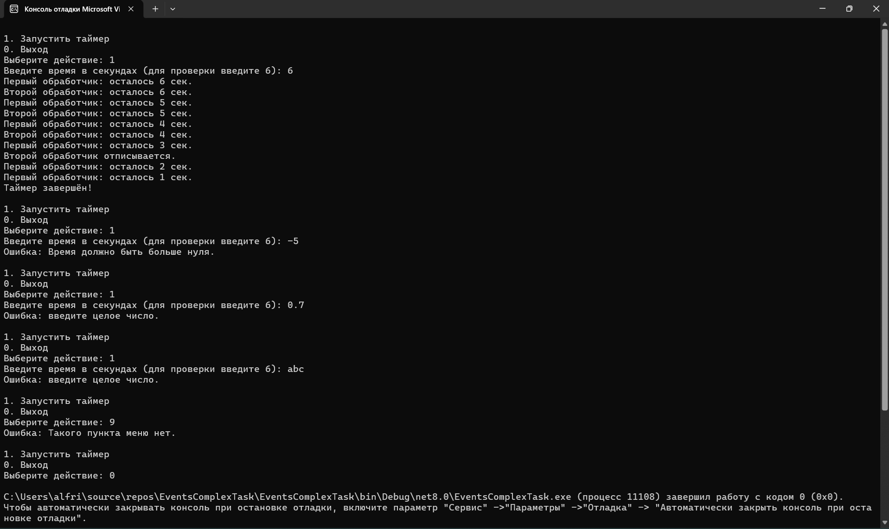

# EventsComplexTask
## Задание «Контрольная точка №22 — события, комплексное задание»
# Вариант 1. Таймер обратного отсчёта
1. Класс CountdownTimer с событиями event EventHandler<int>? Tick (передаёт оставшиеся секунды) и event EventHandler? Finished.
2. Метод Start(int seconds), на каждом шаге уменьшающий счётчик и вызывающий Tick, а при достижении нуля — Finished.
3. Подпишите на Tick минимум два обработчика: один просто выводит оставшееся время, второй должен отписаться от Tick сам, как только оставшееся время станет меньше половины от начального.
4. Подпишите на Finished обработчик, выводящий итоговое сообщение.
5. Продемонстрируйте полный запуск: видно, что второй обработчик Tick перестаёт срабатывать на середине отсчёта, первый — работает до конца, и Finished срабатывает один раз в конце.

# Результаты и проверочные ключи
Для Варианта 1 (Таймер обратного отсчёта), при Start(6):

## Результаты выполнения 

